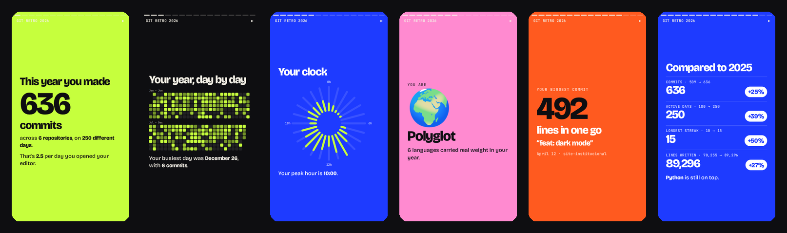
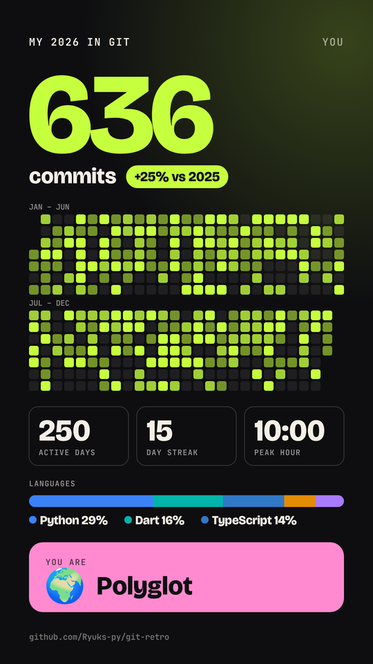

# git retro

**Your year in git, as an animated story you can share.** One command reads the repositories on your machine (private ones included) and turns your commits into a Wrapped-style page: your busiest day, your longest streak, the hour you code the most, your languages, your latest-night commit, how you compare to last year and the kind of developer your commits say you are.

It runs **100% locally**. No account, no token, no upload. Your code never leaves your computer.



**[See the live demo →](https://ryuks-py.github.io/git-retro/)** · [team mode demo](https://ryuks-py.github.io/git-retro/team.html) · [em português](https://ryuks-py.github.io/git-retro/pt.html)

## Quick start

```bash
pipx install git+https://github.com/Ryuks-py/git-retro
git-retro ~/code
```

That's it: it finds every repository under `~/code`, keeps only your commits from this year and opens the page in your browser. Or try it without installing:

```bash
git clone https://github.com/Ryuks-py/git-retro && cd git-retro
python3 -m git_retro ~/code
```

Python 3.10+ and `git`. No other dependencies.

## What's inside

| Slide | What it shows |
|---|---|
| Commits | total, repositories, active days, average per day |
| Lines | written vs. deleted |
| Your year, day by day | a calendar heatmap and your busiest day |
| Month by month | your most productive month |
| Streak | most days in a row with at least one commit |
| Your clock | a 24-hour radial chart and your peak hour |
| Your weekday | which day you commit the most |
| You are… | your strongest trait, out of 11 personas (below) |
| Latest commit | the commit closest to dawn, with its message |
| Languages | share of changed lines per language |
| Repositories | where you spent your time |
| Words of the year | the words you used most in commit messages, and how many commits were fixes |
| Biggest commit | the largest change you made in one go |
| Compared to last year | commits, active days, streak and lines vs. the year before, and whether your top language changed |
| Summary | everything on one page, with **Make a video for stories**: a 14-second animated MP4 (1080×1920) that tells your year in six scenes and ends on your card. On a phone, **Share to Instagram** opens the system share sheet (Stories, Feed, WhatsApp, LinkedIn…). The still image is there too. |



The video is encoded in your browser with WebCodecs and muxed into a regular MP4 (no upload, no ffmpeg). Browsers without WebCodecs fall back to recording in real time.

### Personas

Each one is a measured trait. The page picks the one where you stand out the most; *Office hours* only shows up when nothing else does.

| Persona | When |
|---|---|
| Night owl | 12%+ of commits between midnight and 5am |
| Weekend warrior | 30%+ on Saturday or Sunday |
| Marathoner | a streak of 21+ days |
| Code janitor | deleted 60%+ of what you wrote |
| Firefighter | 35%+ of commits are fixes |
| Polyglot | 4+ languages with at least 5% each |
| Turbo mode | 30%+ of commits on your busiest 10% of days |
| Loyal to one | 80%+ of commits in one repository |
| Early bird | 25%+ before 9am |
| Night shift | 35%+ after 6pm |
| Office hours | none of the above |

Navigate with **← →**, tap the sides, or swipe. Space pauses; press and hold also pauses.

## Team mode

```bash
git-retro --team ~/code/our-product
```

The same story for everyone who committed to those repositories: a **Who did it** leaderboard with each person's persona, **Awards of the year** (most commits, longest streak, latest commit, most lines deleted, most fixes), the team's clock, calendar and languages, and a video with an extra leaderboard scene. Bots like Dependabot and GitHub Actions are left out, and people who used more than one e-mail are counted once. Made for the end-of-year post in the team channel.

## You have more than one e-mail? It figures that out

Most people commit with a personal e-mail, a work e-mail and whatever their laptop had configured. git retro starts from the `user.email` in your git config and joins every e-mail that was used with the same author name. If it still can't find you, it lists who it saw so you can say which one is you:

```bash
git-retro ~/code --author me@personal.dev --author me@company.com
```

## Options

```
git-retro [paths ...]        folders to scan (default: current folder)
  -y, --year 2025            another year (default: this year; last year during January)
  -a, --author EMAIL|NAME    your identity, repeatable
  --name "Ana"               name on the first slide
  --lang pt|en               page language (default: from your system)
  --no-messages              hide commit messages from the page
  --anonymize                show repositories as projeto-A, projeto-B…
  -o, --output FILE          output file (default: git-retro-YEAR.html)
  --depth 4                  how deep to look for repositories
  --team                     the whole team: leaderboard and awards
  --demo                     a made-up year, to see it without your data
  --no-open                  don't open the browser
```

Sharing the page from work? `--no-messages --anonymize` keeps the stats and drops anything that could identify a client or project.

## How the numbers are counted

- Only commits **authored** in the chosen year, by you, across all branches, without merge commits. The same commit in two clones counts once.
- Lines ignore dependency and build folders (`node_modules`, `venv*`, `site-packages`, `vendor`, `dist`, `build`, migrations…), lock files, minified files, images and fonts.
- A single file with more than 5,000 changed lines, a data file (JSON, CSV, SQL…) with more than 1,500, or a whole commit with more than 30,000 is treated as generated or imported.
- What was left out is reported only in your terminal, never on the page you share.

## Privacy

The output is a single HTML file with the numbers and fonts inside. It loads nothing from anywhere, so it works offline and makes no network requests. What ends up in it: aggregate stats, repository names, your most used commit words and two commit messages (latest and biggest). Use `--no-messages` and `--anonymize` to remove them.

## Development

```bash
python3 -m unittest discover -s tests -t .
python3 -m git_retro --demo        # regenerate with fake data
```

## Author

Made by David Montanha · [portfolio](https://ryuks-py.github.io)

## License

MIT. Bundled fonts: [Bricolage Grotesque](https://github.com/ateliertriay/bricolage) and [JetBrains Mono](https://github.com/JetBrains/JetBrainsMono), both under the SIL Open Font License (see `git_retro/fonts/`).

---

<details>
<summary><b>Em português</b></summary>

**A sua retrospectiva do ano no git, em formato de stories.** Um comando lê os repositórios do seu computador (inclusive os privados) e gera uma página animada: dia mais intenso, maior sequência, horário em que você mais programa, linguagens, o commit mais tarde da noite, a comparação com o ano anterior e que tipo de programador seus commits dizem que você é.

Roda **100% local**: sem conta, sem token, sem upload.

```bash
pipx install git+https://github.com/Ryuks-py/git-retro
git-retro ~/projetos
```

A página sai em português se o seu sistema estiver em português (ou use `--lang pt`). Usa mais de um e-mail nos commits? Ele junta sozinho os e-mails que aparecem com o mesmo nome; se precisar, passe `--author` quantas vezes quiser. Para compartilhar sem expor cliente nem projeto: `--no-messages --anonymize`.

</details>
